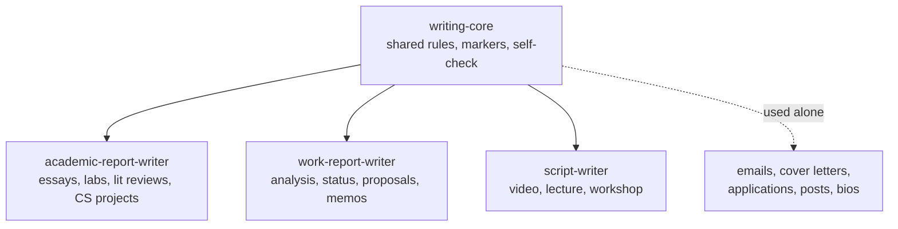
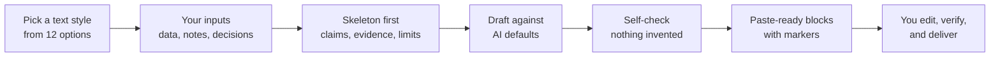

# Writing Toolkit Skills

[](LICENSE)


Four [Agent Skills](https://agentskills.io/specification) for Claude that help you write non-fiction: university reports, work reports, and scripts for videos, lectures, and workshops.

The skills push Claude away from generic AI defaults and toward writing built on **your** data, decisions, and experience. The rules are grounded in [StoryScope](https://arxiv.org/abs/2604.03136) (COLM 2026), a large study of how AI-written text differs from human writing.

---

## Contents

- [Why this exists](#why-this-exists)
- [The skills](#the-skills)
- [How the skills fit together](#how-the-skills-fit-together)
- [How a request flows](#how-a-request-flows)
- [Text styles](#text-styles)
- [Research basis](#research-basis)
- [Markers](#markers)
- [Before and after](#before-and-after)
- [Installation](#installation)
- [Usage examples](#usage-examples)
- [Customizing](#customizing)
- [Repository structure](#repository-structure)
- [Limitations](#limitations)
- [Responsible use](#responsible-use)
- [Citation](#citation)
- [License](#license)

---

## Why this exists

Ask any AI model to "write the results section of my report" and you get text that looks like everyone else's. StoryScope measured this directly: five different LLMs, given the same prompts, produced stories that cluster in one narrow region, while human writing is more spread out and rarer.

Two findings from the paper shaped these skills:

1. **The generic default comes from missing inputs.** The model fills gaps with the most typical choice. The fix is to give it what only you have: your data, your decisions, what failed, your opinion.
2. **Paraphrasing does not fix it.** Rewriting clichés and purple prose barely changed how AI-like the writing was at the structural level. What makes writing yours is its decisions (which evidence, what order, what conclusion), not its synonyms.

So these skills do four things:

- **Ask which text style you want** at the start of every new task, from a menu of 12.
- **Ask for your material first**, and leave clear markers where it is missing instead of inventing anything.
- **Write against known AI defaults:** over-explaining, vague references, tidy stories with no loose ends, and decorative language.
- **Give you paste-ready text** plus pointers to the structural choices worth making your own.

## The skills

| Skill | Use it for | What you get |
|---|---|---|
| [`writing-core`](skills/writing-core/SKILL.md) | Shared rules for all non-fiction. Also used alone for emails, cover letters, applications, posts, and bios. | Rules, markers, and a self-check that the other three skills load |
| [`academic-report-writer`](skills/academic-report-writer/SKILL.md) | University work: technical/CS project reports, lab reports, literature reviews, essays, reflections | Paste-ready blocks, an edit guide, and citations in Harvard, APA 7, or IEEE |
| [`work-report-writer`](skills/work-report-writer/SKILL.md) | Work reports from your data: analysis reports, status updates, proposals, meeting summaries, memos | A full draft with the executive summary first, numbers computed with code, and a "check before sending" list |
| [`script-writer`](skills/script-writer/SKILL.md) | Anything spoken: video scripts, lectures with speaker notes, workshop facilitator guides, talks | Scripts written for the ear, with timing, visual cues, and rehearsal notes |

None of the skills write fiction. Stories, poems, and lyrics are out of scope.

## How the skills fit together



- **One shared core.** Fix a rule once in `writing-core` and every family skill benefits.
- **Family skills split by medium**, because the rules differ: a recap is filler in a report but helps listeners in a lecture.
- **Each family skill tells Claude to load `writing-core` first**, and carries a short fallback copy of the core checklist so it still works if the core is not installed.

## How a request flows



The skeleton step copies the paper's own method. StoryScope turned every story into a structured template before comparing anything, because templates force reasoning about content instead of wording.

## Text styles

At the start of every new writing task, Claude shows this menu and asks which style you want. Reply with one number, or combine two (for example `2 + 4`: formal register with technical precision). Follow-up edits on the same piece keep the style you picked.

| # | Style | What it does | Recommended in |
|---|---|---|---|
| 1 | Plain and clear | Common words, short to medium sentences, active voice. The default | Any skill |
| 2 | Formal academic | Impersonal, no contractions, precise hedging, field terms defined once | `academic-report-writer` |
| 3 | Professional | Direct and polite, answer first, no slang | `work-report-writer`, emails |
| 4 | Technical | Exact terms, versions, units, parameters, and names | `academic-report-writer`, `work-report-writer` |
| 5 | Conversational | Friendly, contractions, speaks to "you" | `script-writer`, posts |
| 6 | Persuasive | Claim, strongest evidence, objection answered, clear ask | Proposals, cover letters |
| 7 | Concise executive | Shortest form, numbers and decisions first | Status updates, memos |
| 8 | Reflective personal | First person, named feelings tied to real moments | Reflections, personal statements |
| 9 | Teaching | Step by step, terms defined, example before the rule | Lectures, workshops |
| 10 | Storytelling | Hook, your real story, tension, payoff | Videos, talks |
| 11 | Simple English | Very common words, no idioms, for non-native readers | Instructions, notices |
| 12 | Match my writing | Mirrors a sample of your writing that you paste | Any skill |

Claude skips the question when you already named a style ("make it formal"), when you say "same style" or "you choose", when the task has no text for you to use (explaining a concept, formatting citations), or when the session runs unattended. It then uses the closest or the first recommended style and says which in one line.

No style turns off the core rules. Every style still uses your real material only, leaves markers for gaps, and avoids the AI defaults. Storytelling and Reflective never invent stories or feelings.

The full definitions live in [`writing-core`](skills/writing-core/SKILL.md) (Rule 0). Each family skill carries a short copy of the list so it still works alone.

## Research basis

**Paper:** Russell, Rajendhran, Pham, Iyyer, and Wieting. *StoryScope: Investigating idiosyncrasies in AI fiction.* COLM 2026. [arXiv:2604.03136](https://arxiv.org/abs/2604.03136)

**What they did:** 10,272 human-written short stories, each paired with stories written from the same prompt by five LLMs (Claude, GPT, Gemini, DeepSeek, Kimi). That is 61,608 stories of about 5,000 words each. They extracted 304 interpretable narrative features and trained classifiers on them.

**Headline results:**

- Narrative features alone, with all style features removed, separated human from AI stories at **93.2% macro-F1**.
- Light editing to remove AI clichés barely mattered: detection went from **95.5% to 93.9%**.
- Human stories were rarer in feature space (mean rarity percentile **0.71 vs 0.49** for AI).

**Findings that became rules:**

| Paper finding (AI vs human) | Rule in these skills |
|---|---|
| Narrator states the theme outright: 77% vs 52% | State each point once. Cut closing sentences that restate it. |
| Vague allusions: 72% vs 50%. Humans name specific works 47% vs 24% | Name the source, tool, dataset, version, and number, or leave a `[CITE]` marker |
| No subplots: 79% vs 57%. Morally ambivalent protagonists: 38% vs 59% | Include real failures, trade-offs, limitations, and one open question |
| Emotion shown through the body: 81% vs 38%. Plain emotion labels: 8% vs 29% | Plain, literal language. In reflections, name feelings directly |
| Humans reinterpret earlier scenes after a surprise more often (3.28 vs 2.95 on a 1 to 5 scale) | Link the discussion back to earlier assumptions and decisions |
| Claude's fingerprint: restraint, epilogues, reverence for tradition (62% vs 39 to 56% for other sources) | Take a position, critique at least one source, and avoid "as AI continues to evolve" endings |
| All five models converge on one region of narrative space | Your inputs first. `[YOUR INPUT]` markers instead of invented content |

**Important caveat:** the paper studied fiction. Applying its findings to reports and scripts is an analogy, not a measured result. The script rules also draw on general teaching research (Freeman et al., 2014, on active learning; Mayer's redundancy principle), not on StoryScope.

The full breakdown, including per-model fingerprints and what does not transfer, is in [docs/research-basis.md](docs/research-basis.md).

## Markers

All four skills use the same markers. They sit in square brackets and capitals so you cannot miss them before you submit or send anything.

| Marker | Meaning |
|---|---|
| `[YOUR INPUT: ...]` | Your data, decision, opinion, example, or experience goes here |
| `[CITE: ...]` | This claim needs a source. The marker says what kind |
| `[VERIFY: ...]` | Claude is not sure of this detail: a date, version, number, or reference field |
| `[FIGURE: ...]` | A suggested figure, chart, or table and what it should show |

The skills never invent data, results, quotes, experiences, references, page numbers, or DOIs. They leave a marker instead.

## Before and after

A results paragraph for a machine learning project report.

**Generic AI draft:**

> The results of this project clearly highlight the importance of data preprocessing. Various techniques were explored, and the model achieved impressive performance, demonstrating the pivotal role of machine learning in today's fast-paced world.

**With `academic-report-writer`:**

```text
The tuned XGBoost model reached [YOUR INPUT: macro-F1] macro-F1 on the held-out test set, compared with [YOUR INPUT: baseline score] for the logistic regression baseline. Most of the gain came after duplicate rows were removed from the training split. Before that, validation scores were inflated by [YOUR INPUT: gap] points. The model still confuses [YOUR INPUT: two classes], which share most of their features [CITE: dataset documentation].
```

The second version names the model, the baseline, and a real failure. It ends on a specific open problem instead of a moral. Every gap is a marker, not an invented number.

## Installation

The skills follow the open [Agent Skills specification](https://agentskills.io/specification). Each one is a folder with a single `SKILL.md`.

### Claude app (web, desktop, Cowork)

1. Clone or download this repository.
2. Package each skill as a ZIP. The skill folder must be the top level of the archive:

   ```bash
   bash scripts/package.sh
   ```

   This builds `dist/writing-core.zip`, `dist/academic-report-writer.zip`, `dist/work-report-writer.zip`, and `dist/script-writer.zip`.

   Without the script, zip each folder from inside `skills/`:

   ```bash
   cd skills
   zip -r ../writing-core.zip writing-core/
   ```

3. In Claude, open **Customize > Skills**, upload each ZIP, and turn the skills on.
4. Install `writing-core` together with any family skill you use.

### Claude Code

Copy the skill folders into your personal skills directory:

```bash
mkdir -p ~/.claude/skills
cp -r skills/* ~/.claude/skills/
```

Claude loads a skill when your request matches its description, then asks which text style you want. You can also run one directly, for example `/academic-report-writer`.

For a single project, use `.claude/skills/` inside that repository instead.

## Usage examples

You do not need to name the skill. Describe the task and Claude picks the matching skill.

**academic-report-writer**

- "Help me write the evaluation section of my ML project report. IEEE style. Here are my results and the baseline numbers."
- "Review my reflection draft for the software engineering course."
- "Convert these five references from APA 7 to Harvard."

**work-report-writer**

- "Here is the CSV of last month's lesson completions. Write a report for my manager on what changed after the March update."
- "Turn these meeting notes into a summary with action items."
- "Draft a one-page proposal to add an AI tutor feature. Here are the usage numbers."

**script-writer**

- "Write a 6-minute YouTube script explaining LoRA fine-tuning. Voiceover with screen recording."
- "Plan a 50-minute lecture on gradient descent for second-year students, with slides and speaker notes."
- "Build a 2-hour hands-on workshop guide on building a FastAPI backend, for 25 students."

**writing-core (alone)**

- "Write a cover letter for this AI engineer internship. Here is the job post and my CV."
- "Draft an email to my professor asking for an extension on the lab report."

## Customizing

- **Text styles:** add or rename a style in the menu under Rule 0 in `skills/writing-core/SKILL.md`, then update the short list in each family skill's "Step 0.5" so they stay in sync.
- **Voice:** each skill defaults to clear, plain English. Share a sample of your own writing in a conversation and the skills mirror it. To make it permanent, edit the "Voice" section in `skills/writing-core/SKILL.md`.
- **Add a report type:** add a section under "Report types" in `academic-report-writer`, or under "Variants" in `work-report-writer`.
- **Citation style:** your university's style guide always wins over the examples in `academic-report-writer`. Replace the examples if your university uses a local Harvard variant.
- **Keep fallbacks in sync:** each family skill has a short copy of the core checklist in its "Step 0". If you change a core rule, update those copies too.
- **Test changes:** Anthropic's [skill-creator](https://github.com/anthropics/skills/tree/main/skills/skill-creator) skill can run your edited skill on test prompts and compare the output with a run without the skill.

## Repository structure

```text
writing-toolkit-skills/
├── README.md
├── LICENSE
├── docs/
│   └── research-basis.md        # Full paper summary and how each finding maps to a rule
├── scripts/
│   └── package.sh               # Builds upload-ready ZIPs into dist/
└── skills/
    ├── writing-core/
    │   └── SKILL.md
    ├── academic-report-writer/
    │   └── SKILL.md
    ├── work-report-writer/
    │   └── SKILL.md
    └── script-writer/
        └── SKILL.md
```

## Limitations

- **Fiction to non-fiction is an analogy.** StoryScope measured AI fiction. The mapping to reports and scripts is reasoned, not tested.
- **Not formally benchmarked yet.** The skills have not been run through a with-skill versus without-skill evaluation. Feedback and evaluation results are welcome as issues.
- **Script rules come from general practice.** They do not come from StoryScope.
- **Harvard has many local variants.** Follow your institution's guide when it differs from the examples.
- **Skills guide Claude. They do not guarantee output.** Always read, check, and edit what you use.

## Responsible use

These skills are built to help you write better and more specific work from your own material. They are not built to hide AI use or to evade AI detectors.

- Follow your university's or employer's rules on AI assistance and how to acknowledge it.
- You are responsible for every fact, number, and citation you submit or send. Check the `[VERIFY]` items and the sources.
- Remove personal data about students, customers, or colleagues before you share files with any AI tool.

## Citation

If these skills are useful in your work, please cite the paper they are built on:

```bibtex
@inproceedings{russell2026storyscope,
  title     = {StoryScope: Investigating Idiosyncrasies in AI Fiction},
  author    = {Russell, Jenna and Rajendhran, Rishanth and Pham, Chau Minh and Iyyer, Mohit and Wieting, John},
  booktitle = {Conference on Language Modeling (COLM)},
  year      = {2026},
  eprint    = {2604.03136},
  archivePrefix = {arXiv}
}
```

## License

[MIT](LICENSE) © 2026 Jawad Alarman
