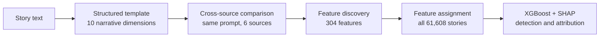

# Research basis

This document explains the study behind the skills, what it found, how each finding became a writing rule, and where the mapping stops working.

**Paper:** Jenna Russell, Rishanth Rajendhran, Chau Minh Pham, Mohit Iyyer, and John Wieting. *StoryScope: Investigating idiosyncrasies in AI fiction.* Conference on Language Modeling (COLM), 2026. [arXiv:2604.03136](https://arxiv.org/abs/2604.03136). Code and data: [github.com/jenna-russell/storyscope](https://github.com/jenna-russell/storyscope).

All numbers below come from the paper. Interpretations of how they apply to non-fiction are ours and are marked as such.

---

## 1. The question

Most work on detecting AI writing looks at surface style: word choice, sentence structure, em dashes, words like "delve" and "tapestry". Those signals are strong but fragile. Newer models and simple edits remove them.

StoryScope asks a different question: **can you tell human and AI fiction apart without using style at all**, only from narrative choices such as plot structure, character agency, and how time is handled?

## 2. Data

| Item | Value |
|---|---|
| Human stories | 10,272 short stories from published anthologies (Books3) |
| Prompts | One writing prompt reverse-engineered from each human story |
| AI sources | Claude Sonnet 4.6, GPT-5.4, Gemini 3 Flash, DeepSeek V3.2, Kimi K2.5 |
| AI stories | 51,336 (one per model per prompt) |
| Total corpus | 61,608 stories, mean length about 4,753 words |

Every prompt was written by all six sources (human plus five models), so the comparison is controlled for topic, characters, and setting.

## 3. Method

1. **Structured templates.** Each story was converted into a structured outline across ten dimensions from the NarraBench taxonomy: agents, social network, events, plot, structure, setting, time, revelation, perspective, and style. This forces later steps to reason about content, not wording. In an ablation, the template pipeline found structure-heavy features, while working on raw text found mostly style-heavy ones (only 6 of the top 20 features overlapped).
2. **Comparative analysis.** For 600 held-out stories, a model compared all six versions of the same prompt and wrote down where the sources differ.
3. **Feature discovery.** From those comparisons, 408 candidate features were proposed and deduplicated to **304 interpretable features**, each a closed-form question (scale, binary, categorical, ordinal, or multi-select).
4. **Feature assignment.** Gemini 3 Flash answered all 304 questions for every story. Agreement with human annotators was Cohen's κ = 0.84, higher than human-human agreement (κ = 0.74) on the same items.
5. **Classification.** XGBoost classifiers, with SHAP values to explain which features drive each prediction. **Core features** separate human from AI consistently across all five models. **Fingerprint features** identify one specific model.

## 4. Main results

### Binary detection (human vs AI)

| Feature set | Features | Macro-F1 |
|---|---|---|
| Narrative only (no style) | 257 | **93.2%** |
| Core features only | 30 | 84.8% |
| Core + fingerprint | 101 | 91.1% |
| Narrative + style | 304 | 96.0% |
| Style only | 39 | 85.8% |
| ModernBERT on raw text (baseline) | n/a | 99.9% |

**Reading this correctly:** narrative features are not the strongest detector. A fine-tuned text model on raw text does better. The point is that narrative features are **interpretable** and **robust to surface editing**, and they keep 97% of the performance of the combined model without using style at all.

### Robustness to editing

After an editing framework rewrote cliché, redundant exposition, and purple prose in 278 Gemini stories, narrative-based detection fell only from **95.5% to 93.9%** macro-F1. Surface edits do not change the structural choices.

### Six-way attribution (which source wrote it)

Narrative features reach **68.4%** macro-F1 (chance is 16.7%), and **77.3%** with style added. Human and Claude are the easiest to identify. Gemini, DeepSeek, and Kimi are often confused with each other.

### Convergence and rarity

- The five AI models occupy one tight cluster in narrative space. The mean human-to-AI centroid distance is 1.6 times the mean AI-to-AI distance.
- Human stories are rarer: mean rarity percentile **0.71 vs 0.49** for AI (Cohen's d = 0.83).
- For a given prompt, the human story was the rarest of the six versions 57.8% of the time, against 16.7% by chance.

### Controls

- **Length:** on a length-matched test subset, the narrative model still scored 93.2%.
- **Memorization:** removing prompts where a model may have reproduced a famous story changed results by less than 0.3 points.
- **Topic:** no significant difference in detectability across genres.

## 5. Core features: how AI fiction differs

Values are human vs AI averages across all five models. Scales run 1 to 5. Percentages are how often a specific option appears.

### AI-elevated

| Theme | Feature | Human | AI |
|---|---|---|---|
| Over-explaining | Thematic explicitness and moralizing (scale) | 3.28 | 3.94 |
| Over-explaining | Narrator explicitly comments on the theme | 52% | 77% |
| Over-explaining | Dialogue used for philosophical debate | 34% | 59% |
| Over-explaining | References are vague implicit echoes | 50% | 72% |
| Sensory performance | Emotion shown through the body | 38% | 81% |
| Sensory performance | Setting mirrors characters' feelings (scale) | 3.58 | 4.07 |
| Sensory performance | Smell among the main senses used | 57% | 82% |
| Streamlining | Continuity of one main causal chain (scale) | 3.92 | 4.20 |
| Streamlining | Resolution driven by the protagonist's choice | 46% | 69% |
| Streamlining | No subplots | 57% | 79% |
| Streamlining | Resolution through internal understanding | 27% | 47% |

### Human-elevated

| Theme | Feature | Human | AI |
|---|---|---|---|
| Outside world | Explicit named references to other works | 47% | 24% |
| Outside world | Balanced mix of explicit and implicit references | 37% | 16% |
| Temporal complexity | Reinterpretation of earlier scenes after a surprise (scale) | 3.28 | 2.95 |
| Temporal complexity | Chronological discontinuity (scale) | 2.40 | 2.12 |
| Diversity | Subplots that run parallel to the theme | 42% | 21% |
| Diversity | Morally ambivalent or mixed protagonist | 59% | 38% |
| Diversity | Emotions named with plain labels | 29% | 8% |

## 6. Model fingerprints

| Source | Distinctive narrative habits |
|---|---|
| Claude | Restraint. Event intensity escalates less than in any other source. Frequent epilogues, no dream sequences, quiet endings. Reverent toward literary tradition (62% vs 39 to 56% for other sources) |
| GPT | Gossip and rumor as a plot device (64% vs 44 to 55%). Distant retrospective narration. Subverts expectations more than other models. Leaves reconciliations ambiguous |
| Gemini | The tidiest endings and extended denouements. Bleak, oppressive settings (88%) |
| DeepSeek | Front-loads crucial context that other sources reveal later |
| Kimi | The fewest fingerprints. Sits at the generic center of the AI distribution |

## 7. From findings to rules

This is our interpretation. The paper does not test non-fiction.

| Finding | Why it transfers | Rule |
|---|---|---|
| AI over-explains themes and moralizes | Reports that end each paragraph with "this highlights the importance of" make the same move | State each point once, early. Let evidence carry it |
| AI uses vague allusions and avoids real names | "Studies show" and "various techniques" are the report version | Name sources, tools, versions, datasets, and numbers, or leave a `[CITE]` marker |
| AI tells tidy single-track stories | Reports where everything worked the first time read the same way, and they are also less honest | Include failures, trade-offs, limits, and one open question |
| AI shows emotion through the body and senses | In reports this becomes decorative metaphor. In reflections it becomes "a knot in my stomach" | Plain literal language. Name feelings directly |
| Humans reinterpret earlier scenes | A discussion section can revisit a design choice in light of the results | Link later sections back to earlier decisions |
| Claude's restraint and reverence | In reports this shows up as agreeing with every source and as epilogue endings | Take a position. Critique at least one source. End on a finding |
| AI output converges | Classmates using the same prompt get the same report | Ask for the user's own inputs first. Use `[YOUR INPUT]` markers instead of inventing |
| Surface edits barely matter | Synonym swaps do not make a text yours | Edit guides point to structural decisions, not wording |
| Templates force content reasoning | Outlining claims and evidence before prose works the same way | Skeleton first, then prose |

## 8. What does not transfer

- **Non-linear time.** Flashbacks and delayed reveals are human-elevated in fiction, but most reports follow a fixed template. The skills keep the template and only borrow the idea of revisiting earlier decisions.
- **Breaking the fourth wall.** Humans address the reader more in fiction. That fits essays and reflections a little, and formal reports not at all.
- **Sensory detail in scripts.** Concrete, vivid examples help listeners. The script skill keeps them and only drops decoration.
- **Spoken repetition.** In a report, a recap is filler. In a lecture or video, a short recap helps people learn. The script skill allows recaps of facts and steps, never of morals.

## 9. Limits of the study

These are worth keeping in mind before treating the numbers as universal.

- **Fiction only,** about 5,000 words per story. Shorter or non-narrative text may behave differently.
- **Professional human baseline.** The human stories are published, edited works by professional authors. The AI stories are single generations from a reverse-engineered prompt.
- **LLM-extracted features.** An LLM assigned the feature values. Agreement with humans was high (κ = 0.84), but not perfect.
- **Model versions change.** Fingerprints describe specific 2026 model versions and may shift with newer releases.
- **Overlap exists.** Human stories are rarer on average, but the distributions overlap. Many AI stories are rare and many human stories are typical.

## 10. Other sources used by the script skill

The `script-writer` skill also relies on general teaching research, not on StoryScope:

- **Active learning:** Freeman, S., Eddy, S. L., McDonough, M., Smith, M. K., Okoroafor, N., Jordt, H., and Wenderoth, M. P. (2014). Active learning increases student performance in science, engineering, and mathematics. *Proceedings of the National Academy of Sciences*, 111(23), 8410–8415. https://doi.org/10.1073/pnas.1319030111
- **Redundancy principle:** from Richard E. Mayer's research on multimedia learning. People learn better from visuals plus narration than from visuals, narration, and the same text on screen.
